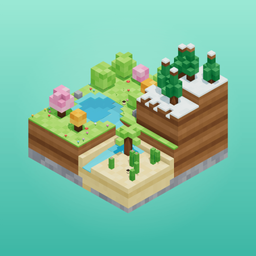
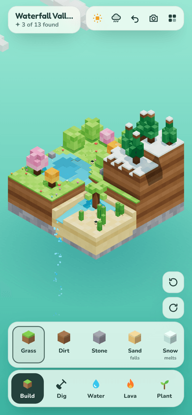
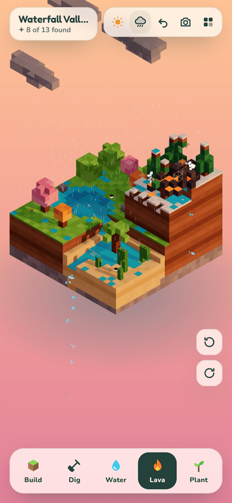
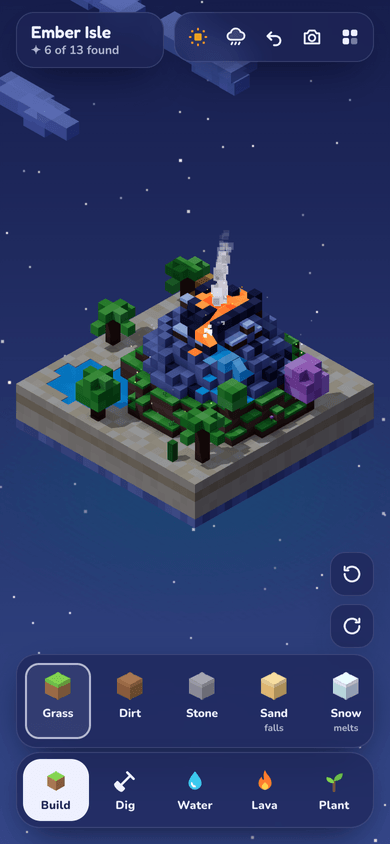

<p align="center"></p>

<h1 align="center">Voxel Worlds</h1>

<p align="center">A cozy ambient sandbox for Android and the web. You build little isometric voxel worlds where water and lava follow real physics.</p>

<p align="center">
  
  
  
</p>

## Install on Android

1. On your phone, open the [**latest release**](../../releases/tag/latest) and download `voxel-worlds.apk`.
2. Open the file. If Android asks, allow your browser to install unknown apps.
3. Tap **Install**.

A new APK is built automatically every time `main` changes. Every build is signed with the same key, so a new version installs over the old one and keeps your world.

## What you can do

- **Build and dig** with 15 block types: grass, dirt, stone, sand, snow, planks, brick, log, three kinds of leaves, obsidian, lanterns, water springs and lava vents.
- **Pour water and lava.** Both are simulated as real volumes of liquid:
  - **Water** falls, levels out, fills basins, evens out through tunnels and pours off the edge of the island as a waterfall.
  - **Lava** is thick and slow. It piles up and creeps along, and thin flows cool into basalt.
- **Watch things react:**
  - Lava and water make obsidian (or basalt) in a puff of steam.
  - Lava melts snow into meltwater, scorches grass and sets plants and trees on fire.
  - Sand falls, and sinks through water.
  - Rain fills hollows, and tree canopies keep the ground under them dry.
- **Grow a garden.** Grass spreads over bare dirt and flowers bloom beside water. Saplings grow into the right tree for the ground they're on: box trees on grass, pines on snow, palms or cacti on sand.
- **Three worlds to start from:**
  - **Waterfall Valley:** a snowy bluff, a spring-fed pond and a waterfall onto the dunes.
  - **Ember Isle:** a volcano that erupts in bursts, with a snowcap and a lagoon.
  - **Quiet Meadow:** a blank plot with one spring.
- **Day cycle:** dawn, day, golden hour and night, with fireflies, glowing lanterns and lava. It changes by itself, or tap the sun to pick a time.
- **13 discoveries** to unlock, such as *Obsidian*, *Snowmelt* and *Great lake*.
- **Photo mode** captures your world with the sky behind it. In the app, **Share** sends the picture straight to Instagram, Photos or Messages.
- **Undo**, plus a soft generative soundtrack that reacts to running water, lava and rain.

Your world saves automatically. In the app, saves live in an on-device SQLite database, so they survive Android clearing the WebView's storage, app updates and force-stops.

## Controls

| | Phone | Computer |
|---|---|---|
| Use the selected tool | Tap, or drag to paint along one layer | Click or drag |
| Pour water or lava | Press and hold | Hold the mouse button |
| Spin the island | Drag on the sky, twist with two fingers, or use the turn buttons | Right-drag, or <kbd>Q</kbd> / <kbd>E</kbd> |
| Zoom and pan | Pinch, two-finger drag | Mouse wheel, middle-drag |
| Pick a tool / undo | Tool bar and undo button | <kbd>1</kbd>–<kbd>5</kbd> / <kbd>U</kbd> |
| Close a panel | Android back button | <kbd>Esc</kbd> |

## Run it in a browser

```bash
python -m http.server 5180
```

Then open http://localhost:5180. The browser version loads three.js and the fonts from a CDN. The app bundles them, so the APK works fully offline.

## Build the APK yourself

You need Node 22, JDK 21 and the Android SDK (set `ANDROID_HOME` if it isn't in the default location).

```bash
npm install
```

```bash
npm run apk
```

The APK lands in `dist/voxel-worlds.apk`. The other scripts:

- `npm run build` assembles `www/`: the web app plus local copies of three.js, the fonts and Capacitor's runtime.
- `npm run sync` builds `www/` and copies it into the Android project.
- `npm run icons` regenerates the launcher icons and splash screens from the images in `resources/`. Those images are rendered from the game itself.

The GitHub Actions workflow in `.github/workflows/android.yml` runs the same `npm run apk` and publishes the result to the `latest` release.

## How it's made

| File | What it does |
|---|---|
| `sim.js` | The world (a 24 × 24 × 24 voxel grid), fluid flow, reactions, plant growth, the three starting worlds and the save format. It doesn't draw anything, so it also runs in Node. |
| `render.js` | three.js renderer. It builds the meshes (with baked ambient occlusion and the grass and snow lips over block edges), wavy fluid surfaces, voxel particles, drifting clouds whose shadows cross the island, rain and the day cycle. |
| `main.js` | Touch and mouse input, tools, sound, discoveries, photo mode, saving and the Android back button. |
| `storage.js` | Mirrors saves into SQLite inside the app and restores them before the game starts. |
| `android/` | The Capacitor Android project (app id `com.voxelworlds.app`). |

The fluids work like this: every cell holds an amount of water or lava. Each tick, liquid flows down first, then spreads sideways to even out with its neighbours, and any excess under pressure gets pushed up. That's enough for pools to find their level and for water to pour off the edge on its own. Lava does the same, but it updates less often, spreads less and stops spreading when it gets thin, which is why it heaps up and crusts over.

You can try the simulation without a browser:

```bash
node -e "const PB=require('./sim.js'); const w=new PB.World(); w.generate('valley'); for (let i=0;i<500;i++) w.step(); console.log(w.stats)"
```

Built with [three.js](https://threejs.org) and [Capacitor](https://capacitorjs.com). It's a sibling to [Pomodoro Terrarium](https://github.com/dalecri/pomodoro-terrarium).
